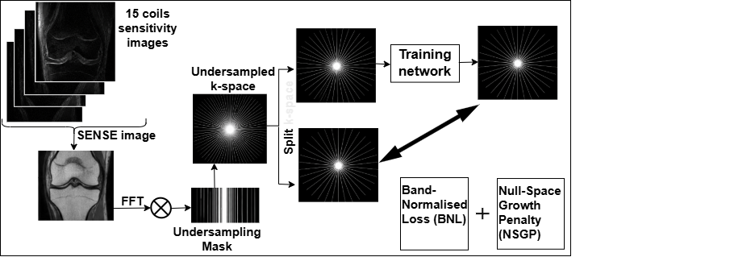
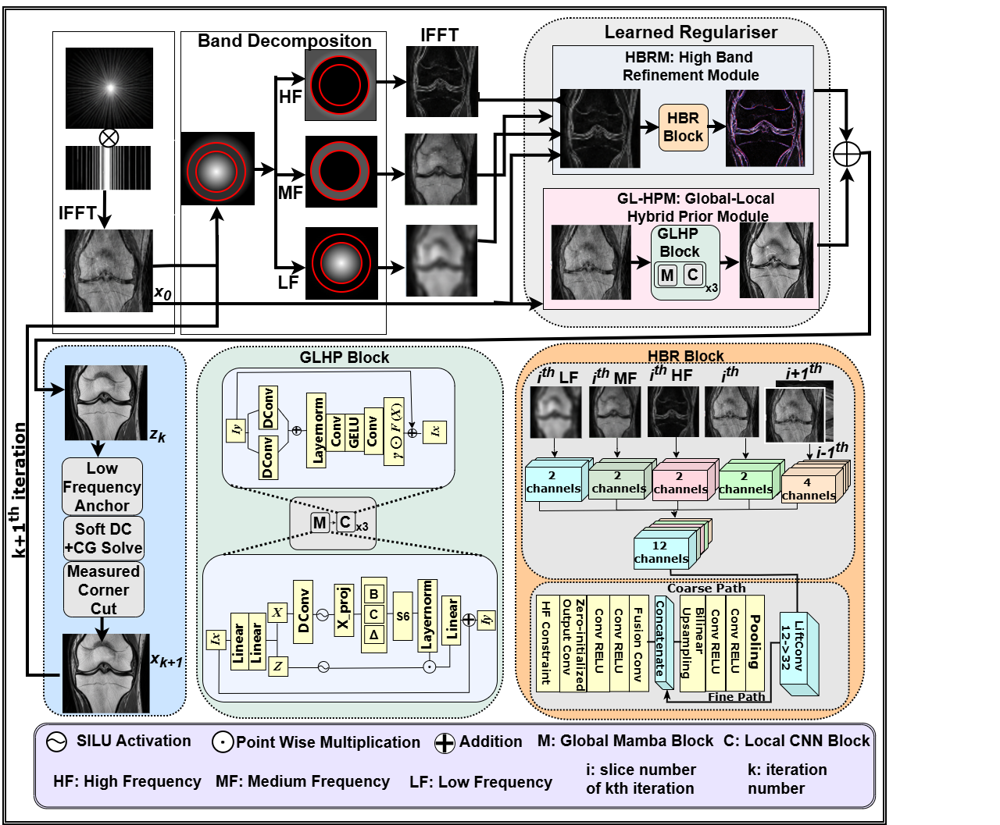
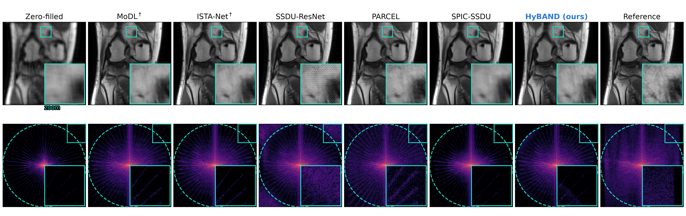
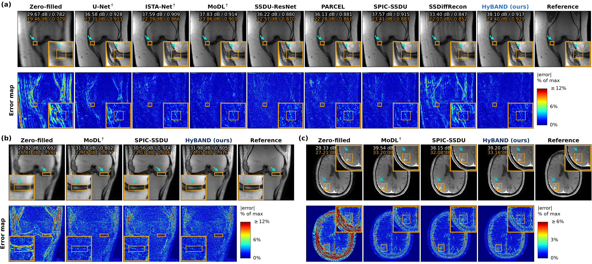

# HyBAND

**HyBAND: Band-Normalised Self-Supervised Reconstruction for Accelerated MRI**

Reference implementation of **HyBAND**, a self-supervised MRI reconstruction network trained **without fully sampled ground-truth images**.

HyBAND uses a **10-step unrolled reconstruction** with shared weights. Its learned regulariser separates spatial-frequency information into complementary routes:

- **Global–local prior:** captures image-wide structure and local details.
- **High-band refinement:** explicitly refines high-frequency information.
- **Null-space growth constraint:** suppresses the generation of k-space energy that was never acquired.

**457,249 trainable parameters.**

---

## Architecture
<p align="center">
  
  <br>
  <em>Overview of the HyBAND Training method.</em>
</p>
<p align="center">
  
  <br>
  <em>Overview of the HyBAND reconstruction framework.</em>
</p>

For each of **K = 10 unrolls**, with weights shared across unrolls:

| Component | Module | Description |
|---|---|---|
| Band split | `hyband/models/bands.py` | LF/MF/HF raised-cosine radial windows that exactly partition the input |
| Global–local prior | `hyband/models/network.py` → `GlobalLocalPrior` | Alternating Mamba (VSS) and dual-kernel ConvNeXt blocks with 80 features |
| High-band route | `hyband/models/network.py` → `HighBandRefiner` | Coarse-to-fine CNN operating on the frequency bands and image |
| Data consistency | `hyband/models/dc.py` | Conjugate-gradient data-consistency solve |
| Null-space constraint | `hyband/losses.py` | Penalises growth of out-of-mask k-space energy between unrolls |
| SSDU masks | `masks/ssdu_masks.py` | Generates the Θ/Λ partition used by SSDU |

The modules above belong to the reference implementation, which is released on
publication — see [Code Availability](#code-availability).

The network uses the training partition **Θ**, while the self-supervised loss is evaluated on the held-out partition **Λ**. Neither corresponds to the fully sampled k-space.

---

## Results

Results are scored against the **ESPIRiT coil-combined (SENSE) reference**.

Lesion metrics are computed **inside fastMRI+ annotation boxes only**.

### Qualitative results
<p align="center">
  
  <br>
  <em>Spectral Energy of the models.</em>
</p>
<p align="center">
  
  <br>
  <em>Representative reconstruction results.</em>
</p>

---

## Data

HyBAND is trained and evaluated on the [fastMRI](https://fastmri.med.nyu.edu/) knee and brain datasets, with lesion annotations from [fastMRI+](https://github.com/microsoft/fastmri-plus).

The datasets and annotations are **not redistributed** with this repository. Users must obtain them under their respective terms.

Training and evaluation require a CUDA-capable GPU. The Mamba blocks use
`mamba-ssm`; on GPUs without a compatible fused kernel, `MAMBA_REF=1` selects a
pure-PyTorch scan instead.

---

## Code Availability

This repository currently holds the paper's figures, this description, and the
entry points that drive reconstruction and scoring. The implementation they
call — model, training loop, SSDU data pipeline and metric code — will be
released here upon publication, at which point these scripts become runnable.

```text
README.md             this file
LICENSE.md            licence
assets/               architecture and results figures
test.py               reconstruct and score in one pass
inference.py          reconstruct a split and save to .h5
requirements.txt      pinned dependencies
```

The scripts import modules that are not part of this repository yet, so they do
not run as they stand.
